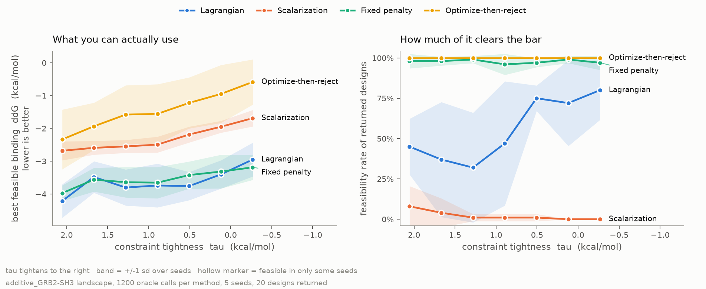
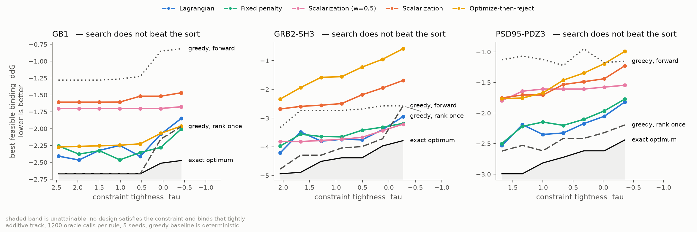
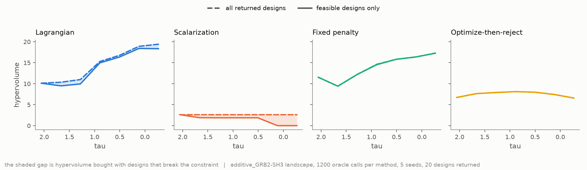
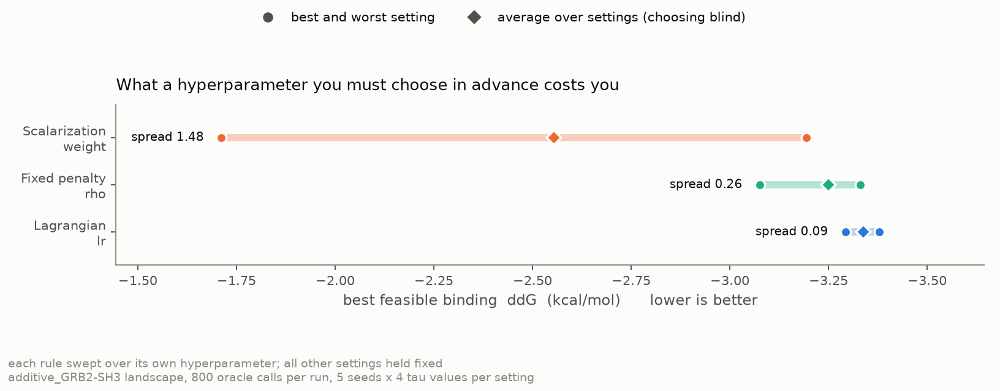
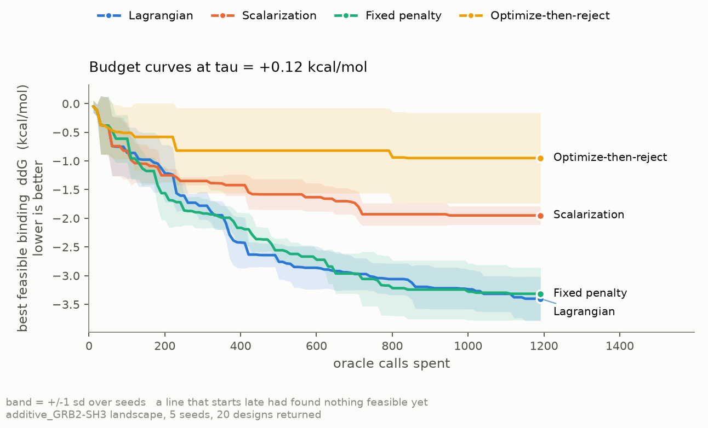
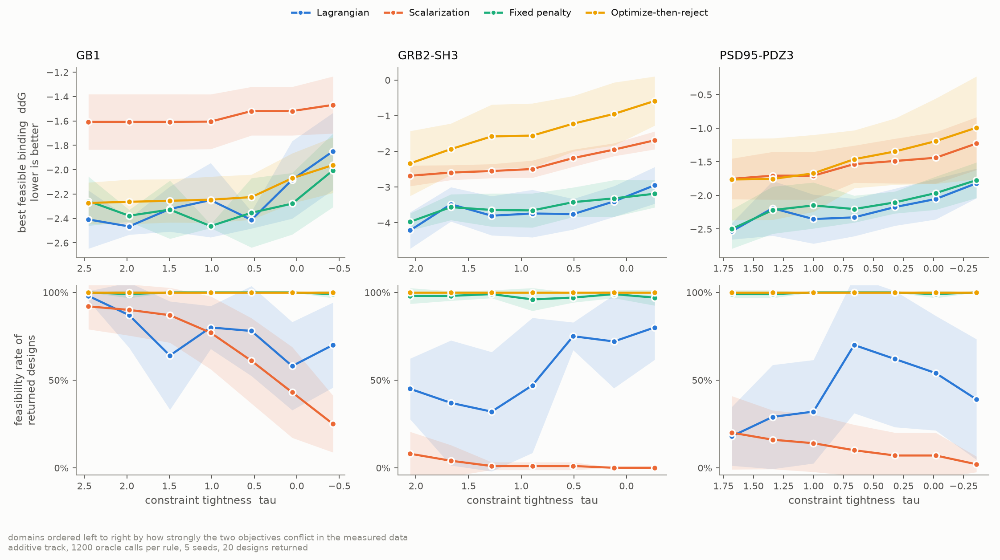

# constrained-protein-design

**When one design objective is a hard constraint rather than something to trade off, do standard multi-objective methods produce usable designs?**

```
maximize    binding affinity      (minimize ddG_binding)
subject to  ddG_folding <= tau    (the protein must stay folded)
```

A binder that does not fold is not a different point on the Pareto front. It is
worthless. But the metric the field reports — hypervolume — pays for it anyway.

This repo benchmarks four constraint-handling rules through a single shared
search engine, on a landscape built from **experimentally measured** folding and
binding free energies, and reports **feasibility rate**: the fraction of
returned designs that actually satisfy the constraint — a metric standard in
constrained optimization and essentially absent from multi-objective protein
design. See [relation to prior work](#relation-to-prior-work) for what that
does and does not claim.

> **Read these two sections first, in order.**
> [Is the problem hard?](#before-any-of-that-is-the-problem-hard) — a
> search-free greedy baseline is not beaten by any rule on the measured track,
> and beats them all on one domain, so that track cannot rank the rules on
> design quality as posed.
> [Give the objective a target range](#give-the-objective-a-target-range-and-the-search-advantage-returns)
> — posed the way affinity engineering actually poses it, as a target window
> rather than unbounded minimization, the search advantage returns on all
> three measured domains.

---

## The headline



GRB2-SH3, binding its GAB2 ligand. 1200 oracle calls per rule, 5 seeds, 20
designs returned.

**This is Track 2.** Single-mutant free energies are the measured values from
Faure, Domingo & Schmiedel et al., *Nature* 2022; multi-mutant values are
**composed additively from them, not measured** — the published tables report
energies for singles only. See [the oracle problem](#the-oracle-problem-and-what-the-published-data-actually-supports)
below, which is the single biggest caveat on everything here. The same
comparison on the zero-error Track 1 oracle ranks the rules identically.

**Left:** the best design you can actually use, with selection held identical
across rules. **Right:** how much of what each rule hands over clears the bar.

The two panels disagree, and that is the point. Optimize-then-reject reports
100% feasibility because it discards failures — while filling only a fifth of
the designs it was asked for. The scalarization sweep returns a full set of
twenty designs of which **none** satisfy the constraint.

---

## Before any of that: is the problem hard?

A comparison between search methods is only evidence about search if a method
that does not search would do worse. So: rank the measured singles by binding,
add substitutions one at a time while the constraint still holds, stop at the
order cap. No population, no stochasticity, no hyperparameter. Four oracle
calls after the singles are measured.

Because both objectives on Track 2 are **sums of per-substitution constants**,
the constrained problem is also solvable exactly — by dynamic programming over
the Pareto front of (folding, binding), which is lossless here precisely
because the objectives are separable. So every score below can be stated as a
fraction of what was actually attainable, not just relative to the other rules.



At the tightest constraint, best of 5 seeds per rule, one-sample *t* against the
deterministic baseline:

| domain | exact optimum | greedy, rank once | greedy, forward | best rule | gap | *p* | verdict |
|---|---|---|---|---|---|---|---|
| GB1 | −2.47 | **−1.97** | −0.82 | −2.01 (fixed penalty) | +0.04 | 0.81 | tied |
| GRB2-SH3 | −3.79 | **−2.58** | −2.57 | −3.21 (scalarization `w`=0.5) | +0.63 | 0.096 | not separated |
| PSD95-PDZ3 | −2.44 | **−2.20** | −1.15 | −1.82 (Lagrangian) | −0.38 | **0.019** | **the sort wins** |

Two baselines, both deterministic. *Rank once* sorts the measured singles and
adds while the constraint holds. *Forward* re-scores every candidate addition
on the true oracle at each step — stronger in principle, but one pass costs a
full sweep of the library, so on these domains it runs out of budget before it
can use its advantage. Each rule is tested against whichever of the two did
better.

**No rule reliably beats the sort on any of the three domains, and on PSD95-PDZ3
the sort wins outright.** The best rules capture 68–85% of the attainable
objective; the sort captures 68–90%. On GB1 the sort hits the exact optimum at
five of seven constraint levels while every evolutionary rule falls short.

The gaps between rules that this benchmark was built to measure are 0.03–0.26
kcal/mol. The gap from the best rule to optimal is 0.47–1.21 kcal/mol. **The
shortfall is an order of magnitude larger than the signal.**

### The cause is the oracle, not the rules

Same engine, same rules, same budget, run instead on the synthetic landscape —
which carries 24 coupled position pairs, so the objectives are *not* separable:

```
at the tightest tau, 1200 oracle calls per method
  best rule (Lagrangian)      -3.948
  greedy, rank once           -2.127   in   381 calls
  greedy, forward             -3.062   in  1200 calls

  best rule vs the tougher baseline (forward):
    gap +0.885 kcal/mol, p = 0.046
```

With epistasis present the search wins — but only just, and only against the
stronger baseline by a hair. Against the cheap rank-once sort the margin is
large; against forward selection on the true oracle it is +0.885 kcal/mol at
p = 0.046. Read that as *the search is doing something here and nothing on
the measured track*, not as a comfortable win.

### What this invalidates, and what survives

**Invalidated.** Track 2 cannot rank constraint-handling rules on design
quality. Any such ranking — including ones earlier versions of this README
reported — is measuring a search that is not the binding factor. The Track 2
design-quality numbers are retained below as a record, not as a result.

**Survives.** The failure modes are about *feasibility and yield*, not about
reaching the optimum, and the baseline does not touch them: optimize-then-reject
still spends 5% of its budget on feasible designs and still fills a fifth of the
set, still in proportion to measured conflict strength; the weight sweep still
returns twenty designs of which none are feasible; hypervolume over all designs
still reports improvement where no usable design exists. The
[hyperparameter-robustness result](#3-the-lagrangian-does-not-beat-a-well-chosen-weight--it-beats-having-to-choose)
is a spread across knob settings rather than a ranking against a baseline, and
it replicates on the synthetic track where the search does bind.

**Recovered.** Posed as a target window instead of unbounded minimization,
the same rules on the same oracle beat the same baseline on all three domains.
See [the next section](#give-the-objective-a-target-range-and-the-search-advantage-returns):
what is too easy here is the unbounded objective, not constrained design.

**The generalizable part.** Additive ΔΔG models and per-residue predictors are
common oracles in multi-objective protein design, and a separable oracle makes
the design problem an integer program with no structure for a search to
exploit. A greedy baseline costs one pass over the single mutants plus a
handful of compositions, and detects this. Run one
before reporting a method comparison.

```
python experiments/baselines.py --track additive
python experiments/baselines.py --track synthetic
```

---

## Give the objective a target range, and the search advantage returns

The result above has an obvious reading: constrained design is just easy, so
why bother searching. That reading is wrong, and the reason is in the word
*unbounded*.

Affinity engineering does not usually ask for the tightest binder obtainable.
It asks for one inside a range — binding too tight carries its own
liabilities. Minimizing a sum of constants is a knapsack, and ranking the
terms nearly solves it. Landing a sum *inside an interval* is subset-sum,
where the locally closest step routinely rules out the combination that would
have landed inside.

So the identical comparison runs twice, on the same landscape, engine, budget
and seeds. The only thing that changes is the target:

| | target | cost |
|---|---|---|
| unbounded | drive `ddG_binding` down | `ddG_binding` |
| window | land `ddG_binding` in `[lo, hi]` | `max(lo − b, 0) + max(b − hi, 0)` |

The cost is flat inside the window on purpose. The question a window asks is
*did you hit it*, not *how far past the near edge did you get*; ranking within
the window would quietly restore the unbounded objective.

### How the window was chosen

Fixed before any run, from the landscape alone:

- **Centre at twice the strongest single-mutant binding effect.** Out of reach
  of any one substitution, so the problem is genuinely combinatorial, but
  inside what three or four measured substitutions can reach.
- **Half-width at twice the median standard error on binding.** The data's own
  resolution sets how precisely a target can be meant at all.
- **Widen by doubling the half-width until the window is reachable**, checked
  before any search runs — exactly on the additive track, against a
  first-order surrogate elsewhere. A window nothing can reach is not a hard
  test, it is a broken one. The number of doublings is reported below, because
  a window that needed several is a weaker test than one that needed none.

### The greedy baseline is the fair one

Ranking singles by binding is meaningless against a window, so greedy gets the
best myopic rule available instead: score every legal addition on the **true
oracle**, discard the ones that break the constraint, keep whichever lands
closest to the window, stop on entering it. Handing greedy a rule designed to
fail and then reporting that it failed would prove nothing.

### Result

Tightest τ, 5 seeds, 1200 oracle calls per rule. *Cost* is distance from the
window, so 0.000 means a design landed inside it.

| domain | window | widened | regime | best rule | greedy | gap | *p* | verdict |
|---|---|---|---|---|---|---|---|---|
| GB1 | [−2.11, −2.09] | 0× | unbounded | −2.01 | −1.97 | +0.04 | 0.81 | tied |
| GB1 | | | **window** | **0.16** | 1.28 | +1.11 | **0.0001** | **search wins** |
| GRB2-SH3 | [−3.40, −3.16] | 0× | unbounded | −3.21 | −2.58 | +0.63 | 0.10 | not separated |
| GRB2-SH3 | | | **window** | **0.13** | 0.59 | +0.46 | **0.014** | **search wins** |
| PSD95-PDZ3 | [−5.00, −1.91] | 4× | unbounded | −1.81 | −2.20 | −0.39 | 0.054 | not separated |
| PSD95-PDZ3 | | | **window** | **0.13** | 0.76 | +0.63 | **0.001** | **search wins** |
| synthetic | [−5.74, −4.94] | 2× | unbounded | −3.87 | −2.13 | +1.74 | 0.023 | search wins |
| synthetic | | | window | 1.11 | 1.88 | +0.77 | 0.051 | not separated |

**On all three measured domains the finding flips.** Unbounded, no rule beats
a search-free sort. Against a window, every domain separates, at *p* ≤ 0.014.
The sort never once lands inside the window; the best rule does on all three.

That sharpens the claim rather than retracting it:

> A separable oracle degenerates into a knapsack that a sort nearly solves —
> but only while the objective is unbounded. Give it a target window, as
> affinity engineering does, and the search advantage returns on the same
> oracle, the same engine and the same budget.

### Two things that did not work

**The synthetic track does not reproduce it.** The window regime there is not
separated (*p* = 0.051) and nothing — search or greedy — lands inside. The
reachability check is first-order, and on a landscape with 24 coupled pairs a
first-order model says a window is reachable when the true landscape cannot
reach it. The same additivity that makes the unbounded problem too easy makes
a window look closer than it is. That row does not test the hypothesis and is
not counted as evidence either way.

**PSD95-PDZ3 needed four doublings**, giving a window 3.1 kcal/mol wide,
because centring at twice the strongest single put the target past anything
reachable under that τ. A wide window is an easier target for everyone,
including greedy, so it is the weakest of the three tests — the search still
separates there at *p* = 0.001, so the conclusion does not rest on it, but the
window-selection rule has a real flaw: it never consults the constraint. Fixing
it after seeing the results would be tuning, so it is reported as it ran.

```
python experiments/windows.py --landscape additive --domain GRB2-SH3
python experiments/windows.py --landscape synthetic
```

---

## What actually happened

Tightest constraint, tau = -0.27 kcal/mol. Budget spent on feasible designs is
averaged over every tau; the rest are at the tightest. 5 seeds.

| rule | budget spent on feasible designs | feasible designs delivered | best usable design | designs filled |
|---|---|---|---|---|
| Lagrangian (`lr`=0.5) | 50% | 80% | −2.95 kcal/mol | 100% |
| Fixed penalty (`rho`=10) | 57% | 97% | −3.19 kcal/mol | 100% |
| Scalarization (`w`=0.5) | 77% | 94% | −3.21 kcal/mol | 100% |
| Scalarization (weight sweep) | 52% | **0%** | −1.69 kcal/mol | 100% |
| Optimize-then-reject | **5%** | 100% | −0.59 kcal/mol | **21%** |

Three findings, including one that contradicts the hypothesis this project
started with.

### 1. Optimize-then-reject fails, as predicted

It spends **95% of its oracle budget on designs that break the constraint**, and
at the tightest tau it can only fill 21% of the designs it was asked for. Its
best usable design is 2.6 kcal/mol worse than the best rule's. Maximizing first
and filtering later is not a cheap approximation to constrained design — at a
fixed budget it is a different and much worse algorithm.

### 2. Hypervolume rewards designs nobody can use



For the scalarization sweep, hypervolume computed over all returned designs is
nearly **flat** as the constraint tightens, while hypervolume over the feasible
subset collapses. Reported the usual way, the metric says nothing changed. The
shaded gap is hypervolume bought entirely with designs that would fail.

### 3. The Lagrangian does *not* beat a well-chosen weight — it beats having to choose

At the tightest tau the Lagrangian posts −2.95 against −3.21 for scalarization
at w=0.5 and −3.19 for the fixed penalty. Ranked on the means, it loses. But
those gaps do not survive a significance test across the five replicate seeds
(Welch, p = 0.50 and p = 0.94), and the same holds on all three domains:

| domain | ranking at the tightest tau |
|---|---|
| GB1 | fixed penalty **=** optimize-then-reject **=** Lagrangian **=** scalarization **>** sweep |
| GRB2-SH3 | scalarization **=** fixed penalty **=** Lagrangian **>** sweep **>** optimize-then-reject |
| PSD95-PDZ3 | Lagrangian **=** fixed penalty **=** scalarization **>** sweep **=** optimize-then-reject |

`=` means tied on this evidence; `>` means separated at p < 0.05. The leader
changes between domains, and in every case the top three are indistinguishable.
**The apparent winner is seed noise.** Reporting that ordering as a result would
have been inventing a finding, which is why
[`compare_groups`](src/cpd/metrics.py) now gates every ranking the repo prints.

So the honest verdict on the original hypothesis: **not supported.** The
Lagrangian does not pull ahead as tau tightens — it ties. What it does not do
is lose, and the earlier draft of this README said it did.

The second reason to distrust a ranking on means: w=0.5 and ρ=10 are
*hindsight*. A real run gets one guess at the knob. Sweep each rule over its own:



| rule | knob | best setting | worst setting | choosing blind | spread |
|---|---|---|---|---|---|
| Lagrangian | `lr` | −3.38 (at 0.25) | −3.29 | −3.34 | **0.09** |
| Fixed penalty | `rho` | −3.33 (at 10) | −3.08 | −3.25 | **0.26** |
| Scalarization | `weight` | −3.19 (at 0.7) | −1.71 | −2.55 | **1.48** |

Each cell averages 5 seeds over the four tau values above, at 800 oracle calls —
a different budget and a wider tau range than the headline table, which is why
the absolute numbers differ from it.

At their best settings the three rules sit within 0.19 kcal/mol of each other.
The difference between them is not peak performance — it is **how much it costs
to guess the knob wrong**.

**And unlike the rankings, this one replicates.** The same sweep on all three
domains, spread between the best and worst setting of each rule:

| domain | Lagrangian `lr` | Fixed penalty `rho` | Scalarization `weight` |
|---|---|---|---|
| GB1 | **0.088** | 0.136 | 1.168 |
| GRB2-SH3 | **0.085** | 0.255 | 1.483 |
| PSD95-PDZ3 | **0.129** | 0.205 | 0.928 |

Same ordering every time, on three proteins with different conflict strengths:
the Lagrangian is least sensitive to its knob, the fixed penalty next, the
weighted sum between 7× and 17× worse than the Lagrangian. This is the only
claim in the project that both replicates across domains *and* distinguishes
the rules — the design-quality rankings do neither.

So the honest claim is narrower and more useful than the one this started with:

> Treating a hard constraint as a constraint does not buy a better design than a
> perfectly tuned weighted sum. It buys near-indifference to a hyperparameter
> that cannot be tuned before the run, and it never ships a design set that is
> 0% feasible.

### Where the budget goes



At a middling constraint (tau = +0.12), the Lagrangian and the fixed penalty are
still improving at 1200 calls. Optimize-then-reject is not: it reaches its final
value after about 800 and then flatlines, having found its feasible designs
early by accident and spent the rest of the budget somewhere it cannot use. The
scalarization sweep settles a full kcal/mol short, having split its budget five
ways to hedge a weight choice.

This is the practical reading of the feasibility-rate column. A rule that spends
95% of its assays on designs that break the constraint is not merely scoring
badly on a metric — it is buying nothing with most of its budget.

---

## What the feasibility rate promises, and what it would deliver

Everything above treats the constraint as a noiseless test: a design passes
when its point estimate clears τ. The published ddPCA tables ship a standard
error for every variant and the parser already reads them, so that test
discards information the data provides.

It matters most exactly where the rules work hardest. A constraint-aware
search is *supposed* to settle near the boundary — that is the entire argument
for the Lagrangian — and a design sitting just inside the bar, measured to an
error several times its margin, is a coin flip reported as a pass.

Three readings of the same returned designs:

| | question | |
|---|---|---|
| nominal | does the point estimate clear τ? | what the benchmark reports |
| expected | mean of `P(ΔΔG_folding ≤ τ)` | what the experiment would return |
| confident(α) | `P(ΔΔG_folding ≤ τ) ≥ 1 − α` | what you can promise |

At α = 0.5 the chance constraint *is* the nominal test, since the median of a
normal is its mean, so sweeping α downward traces how fast the promise erodes.

### Result

Tightest τ, 5 seeds, shown as nominal → expected → confident at α = 0.05.

| rule | GB1 | GRB2-SH3 | PSD95-PDZ3 |
|---|---|---|---|
| Optimize-then-reject | 100% → 87% → **47%** | 100% → 98% → 92% | 100% → 88% → **29%** |
| Fixed penalty | 99% → 92% → 69% | 97% → 94% → 83% | 100% → 94% → 72% |
| Lagrangian | 70% → 71% → 61% | 80% → 80% → 76% | 39% → 38% → 28% |
| Scalarization (`w`=0.5) | 100% → 100% → **100%** | 94% → 94% → 94% | 100% → 100% → **100%** |
| Scalarization (sweep) | 25% → 24% → 16% | 0% → 0% → 0% | 2% → 3% → 0% |

**Optimize-then-reject reports a perfect 100% on all three domains and keeps
29–47% of it on two of them.** It filters its trace on point estimates, so it
selects precisely the designs whose margin is smallest relative to their
error — the reported number is as high as it is *because* the test is naive.
At α = 0.01 it falls to 32% and 19%.

**Scalarization at `w`=0.5 loses nothing**, because it never approaches the
boundary. It pays for that in binding, and it is the rule that leaves the most
stability unspent. Honouring the error bars reorders the rules on all three
domains.

So the trade-off the benchmark was set up to measure has a second axis that
the nominal metric hides entirely: the harder a rule presses the constraint,
the less its reported feasibility is worth. That is the same failure as the
[hypervolume problem](#2-hypervolume-rewards-designs-nobody-can-use) — a
metric reporting a promise it cannot keep — on a different quantity.

### The assumption, stated

Composing errors across substitutions adds the published per-variant variances
in quadrature, which treats them as independent. They are not exactly: one
growth-rate assay and one fitted thermodynamic model produce all of them, so
shared systematic error is plausible and would make the true uncertainty
larger. **The gaps above are therefore a lower bound on the real ones.**

```
python experiments/uncertainty.py --domain GRB2-SH3
```

---

## Twenty designs, or one design twenty times?

Every rule is asked for twenty designs and judged on how good the best one is
and how many clear the constraint. Neither question notices whether the twenty
are *different*. A set that collapses onto one region spends an experimental
budget sized for twenty bets on a single bet, and nothing reported so far
would distinguish it from a spread-out set.

Mean pairwise Hamming distance over the **feasible** designs each rule hands
over, in substituted positions, at the tightest τ:

| rule | GB1 | GRB2-SH3 | PSD95-PDZ3 |
|---|---|---|---|
| Lagrangian | 2.55 | 2.50 | 1.58 |
| Fixed penalty | 2.37 | 2.54 | 2.42 |
| Scalarization (`w`=0.5) | 3.15 | 2.16 | 3.08 |
| Scalarization (sweep) | 3.73 | — | 1.00 |
| Optimize-then-reject | 3.27 | **2.17** | 2.67 |

### The suspicion held on one domain of three

Optimize-then-reject already fills only part of the set it was asked for. The
question was whether what survives also sits in one place — a second cost on
top of the first.

**On GRB2-SH3, yes.** It fills 21% of the set, and those few designs touch
**4.0 distinct positions** against 8.0–8.6 for the constraint-aware rules. It
under-fills *and* concentrates.

**On GB1 and PSD95-PDZ3, no.** It fills 100% and 61%, and its surviving
designs are more spread out than the constraint-aware rules', not less
(3.27 and 2.67 against peer averages of 2.69 and 2.36). The suspicion is
wrong on those two and is reported that way.

The pattern that does hold is the familiar one: GRB2-SH3 is the domain where
the two objectives conflict hardest, and it is the only one where
optimize-then-reject fails in both ways at once. Where the constraint is cheap
the rule is merely redundant; where it is expensive, it is narrow as well as
thin.

### Diversity alone is not a virtue

The scalarization sweep posts the highest raw diversity of any rule — 4.1–4.2
mean distance across 14–16 positions — while returning **zero** feasible
designs on GRB2-SH3 and 0.4 on PSD95-PDZ3. It is spread widely across
sequence space that cannot be used. Diversity is only worth reading next to
feasibility, which is why both columns are reported together and why the
table above is computed over the feasible subset rather than the whole
delivered set.

```
python experiments/diversity.py --domain GRB2-SH3
```

---

## Does it replicate? Three domains, and a dose-response

One result on one protein is an anecdote. All three ddPCA domains were run, and
they differ a lot in how much the two objectives actually fight — measured, not
assumed, as the binding you give up to satisfy the constraint:

| domain | binding given up to satisfy the constraint | top-15 binders destabilizing |
|---|---|---|
| GB1 | 0.41 kcal/mol | 73% |
| GRB2-SH3 | 0.76 kcal/mol | 93% |
| PSD95-PDZ3 | 1.12 kcal/mol | 80% |



Two things replicate, and one thing turns out to be conditional.

**Replicates: the weight sweep is reliably worst.** Separated from the leader at
p < 0.05 in all three domains, and it delivers near-zero feasible designs
everywhere. This is the most robust negative result in the project.

**Replicates: the constraint-aware rules tie.** In all three domains the top
three are statistically indistinguishable. No rule wins on design quality.

**Conditional, and this is the useful finding: optimize-then-reject only fails
when the objectives genuinely conflict.**

| domain | conflict | budget spent on feasible designs | designs filled | verdict |
|---|---|---|---|---|
| GB1 | 0.41 | 45% | 100% | **ties the leader** |
| GRB2-SH3 | 0.76 | 5% | 21% | collapses |
| PSD95-PDZ3 | 1.12 | 8% | 61% | collapses |

On the domain where the constraint barely bites, ignoring it costs nothing
measurable. On the two where it bites, the same rule wastes most of its budget
and cannot fill the design set. The failure tracks the underlying biophysics
rather than being a quirk of one protein.

That makes the practical advice conditional and testable rather than universal:
**measure what the constraint costs you at the optimum before choosing a
method.** It is a cheap calculation on the data you already have — no search
required — and it tells you whether you can get away with filtering at the end.

Regenerate with `python experiments/replication.py`.

---

## The designs themselves

Metrics are the contribution, but a design benchmark should show what it
designed. Both tables pool every rule's evaluations at a mid-tightness
constraint and keep only designs that satisfy it, ranked by binding. Negative
ddG binding means tighter binding than wild type; ddG folding at or below the
limit means the protein still folds.

**Track 1 — measured variants, zero oracle error.** These are real assayed
single mutants; both numbers are the published inferred free energies, not
predictions of this work.

Constraint: `ddG_folding <= +0.89` kcal/mol. 171 designs satisfy it; the best six:

| design | ddG binding | ddG folding | found by |
|---|---|---|---|
| `T53G` | **−1.37** | −0.05 | Scalarization (w=0.5) |
| `K37T` | **−1.04** | +0.61 | Lagrangian |
| `H26E` | **−0.88** | −0.66 | Fixed penalty |
| `K37S` | **−0.88** | +0.86 | Scalarization (w=0.5) |
| `Q43D` | **−0.74** | +0.49 | Scalarization (w=0.5) |
| `C40L` | **−0.72** | +0.33 | Lagrangian |

**Track 2 — composed from measured singles under the additive model.** These
combinations were never assayed; their energies are model predictions and carry
the oracle caveat below.

Constraint: `ddG_folding <= +0.89` kcal/mol. 2677 designs satisfy it; the best six:

| design | ddG binding | ddG folding | found by |
|---|---|---|---|
| `H26E,K37D,R49A,T53G` | **−4.12** | +0.71 | Lagrangian |
| `H26E,K37T,R49T,T53G` | **−3.91** | +0.07 | Lagrangian |
| `H26E,K37T,R49N,T53G` | **−3.90** | +0.72 | Lagrangian |
| `G15D,K37T,R49A,T53G` | **−3.90** | +0.41 | Fixed penalty |
| `H26E,K37D,R49S,T53G` | **−3.85** | +0.82 | Lagrangian |
| `H26E,K37T,R49A,T53G` | **−3.79** | −0.74 | Lagrangian |

`H26E,K37T,R49T,T53G` is the one to look at: roughly 4 kcal/mol tighter binding
at a folding cost of +0.07 kcal/mol, which is within the measurement error on
the underlying singles. Under the additive model it is close to free.

Position 37 recurs across the whole table — K37T, K37S, K37D all improve
binding — so the search converges on a binding hotspot that is present in the
measured data rather than scattering over the sequence.

Regenerate with `python experiments/report.py --designs`.

**None of these have been made or tested in a lab.** Track 1 rows are measured
free energies for variants that exist; Track 2 rows are model output. Neither
is a claim about behaviour in a cell.

---

## The oracle problem, and what the published data actually supports

This is where projects like this usually die: a search proposes sequences nobody
measured, so the "ground truth" becomes a model's opinion. Two tracks, both
reported.

**Track 1 — exact oracle.** Design space restricted to the measured variants.
Oracle error is exactly zero.

**Track 2 — additive model.** Combinations of measured singles, scored by summing
their ddGs. This is the first-order term of a MoCHI-style thermodynamic model.
It is a model, and results under it are oracle-dependent by construction.

**A finding from the data itself:** the spec for this project assumed Track 1
would be a *combinatorial* search over measured multi-mutants. It cannot be.
Supplementary Table S7 reports inferred free energies for **single mutants
only** (588 confident singles for GRB2-SH3); Table S6 covers higher-order
variants but holds raw BindingPCA/AbundancePCA *fitness*, not free energies. So
Track 1 is budget-limited **selection** over a few hundred measured variants,
and anything combinatorial is Track 2 and model-dependent. The two tracks rank
the rules identically, but Track 1 compresses all the differences — with only
singles available, every rule finds a decent variant.

**A second finding, and a check that nearly killed the project.** The folding
and binding effects are *not* globally anticorrelated. Correlation between
ddG_folding and ddG_binding at interface positions:

| domain | all positions | interface positions |
|---|---|---|
| GB1 | +0.39 | +0.48 |
| GRB2-SH3 | −0.15 | −0.07 |
| PSD95-PDZ3 | +0.22 | +0.15 |

Mostly *positive* — unsurprising, since a mutation that unfolds a domain also
destroys its binding site. A correlation test alone would have said "no
antagonism here" and ended the project.

The conflict is real but lives in the **tail**, not the correlation. For
GRB2-SH3, the 15 strongest binding improvers have a median ddG_folding of
**+1.94 kcal/mol** and 93% of them are destabilizing. Tightening tau from the
90th to the 5th percentile of the folding distribution costs 0.76 kcal/mol of
achievable binding. The right question was never "are the objectives
anticorrelated" but "what does the constraint cost you at the optimum".

---

## Why the comparison is clean

Every rule runs through the **same** evolutionary search engine, with the same
budget, the same seeds, the same initialization and the same population size.
Only the scalar objective changes. Comparing a policy-gradient agent against
NSGA-II would confound the search algorithm with the constraint-handling
mechanism; this design cannot.

Three choices worth stating, because each one could have quietly rigged the result:

- **The budget binds.** Methods are compared at equal oracle cost, and the run
  asserts that every rule actually spent its full budget rather than running out
  of generations first ([`common.py`](experiments/common.py)). A comparison where
  one method stopped early is not a comparison.
- **Optimize-then-reject filters its whole trace,** not just its final
  population. A weak null hypothesis would make the headline result worthless.
- **The weight sweep is charged for the sweep.** Five weights share one budget,
  split evenly. Handing it five full budgets would make every other rule look
  better than it is.

Results are reported under two readouts, both computed from the same paid-for
trace: **as delivered** (what the rule hands over on its own terms — this is
where the feasibility rate lives) and **feasible-filtered** (every rule made to
discard infeasible designs, so selection is identical and only the search
differs). Reporting only the first would flatter rules that quietly return
unusable designs; only the second would hide that they do.

---

## Relation to prior work

Worth being exact about, because the loose version of this claim is wrong.

**Hypervolume is not broken.** It measures the volume of objective space a
solution set dominates, and it was defined for *unconstrained* multi-objective
problems where every point is a legitimate trade-off. It does that correctly.
The failure shown above is what happens when it is applied **unchanged** to a
problem with a hard constraint, so that violating designs still contribute
volume.

**Constrained optimization already solved the reporting problem.** The
constrained multi-objective evolutionary computation literature has handled
this for decades: hypervolume computed over feasible solutions only, set to
zero when nothing is feasible, with feasibility ratio reported as a matter of
course, against benchmark suites built around constraints (CF, MW, DAS-CMOP,
LIR-CMOP). None of that is new here, and this project claims none of it.

**The gap is in protein design specifically.** Multi-objective protein design
work -- LaMBO, EvoMOBO, MP2D, NSGA-II with ProteinMPNN -- frames these problems
as trade-offs and reports hypervolume and front coverage. Because no
feasibility threshold is defined, feasibility rate never appears. There are
reasonable causes for that, not an oversight:

- for most design objectives there is no principled threshold; what ddG_folding
  counts as "unfolded" is continuous and context-dependent
- until datasets measured *both* properties for the *same* variants, there was
  no measured ground truth to define a constraint against
- Pareto framing is genuinely more useful when the threshold is unknown
- the two literatures barely overlap: constrained-MOEA machinery sits in
  evolutionary computation, protein design ML grew out of generative modelling

**So what is contributed here** is a benchmark, not a method or a metric: a
protein sequence-design problem where the hard constraint is a biophysical
property with experimentally measured ground truth; one search engine with the
constraint rule as the only variable; and a measurement of what the current
protein-design reporting convention hides. The Lagrangian rule itself is
adapted from Ctrl-DNA, and the constraint-handling rules are all standard.

---

## Metrics

- **Feasibility rate** — fraction of returned designs satisfying the constraint.
- **Design yield** — how many of the N requested designs a rule could fill with
  feasible ones. The honest version of "it returned 100% feasible designs".
- **Feasible best-k** — mean binding of the k best feasible designs. Returns
  `NaN` when fewer than k are feasible, rather than averaging over however many
  happen to exist; a rule that returned one feasible design out of a hundred
  should not score like one that returned ten.
- **Violation severity** — how far past tau, when violated.
- **Oracle-call budget curves** — performance against evaluations spent.
- **Hypervolume, twice** — over all designs and over the feasible subset. The gap
  is the argument.

---

## Running it

```bash
pip install -e ".[data,dev]"
pytest                                    # 264 tests, no data or network needed

python data/download.py                   # fetches the ddPCA tables into data/raw/

# Track 2, the headline. Every --budget below is the value recorded in the
# matching results/*_meta.json, so these commands reproduce the committed
# files byte for byte. Where no flag appears the default (1200) is what was
# used.
for d in GB1 GRB2-SH3 PSD95-PDZ3; do
  python experiments/tau_sweep.py    --landscape additive --domain $d
  python experiments/tuning_cost.py  --landscape additive --domain $d --budget 800
done

# Track 1, zero oracle error. The measured library is only a few hundred
# singles, so the budget has to be small enough that a run can actually spend
# it -- check_budget_binds fails loudly otherwise.
for d in GB1 GRB2-SH3 PSD95-PDZ3; do
  python experiments/tau_sweep.py --landscape exact --domain $d --budget 120
done

python experiments/tau_sweep.py --landscape synthetic
python experiments/replication.py         # cross-domain figure and significance tests
python experiments/baselines.py --track additive    # baselines + exact optimum
python experiments/baselines.py --track synthetic   # the same check, with epistasis
for d in GB1 GRB2-SH3 PSD95-PDZ3; do
  python experiments/windows.py --landscape additive --domain $d   # both regimes
done
python experiments/windows.py --landscape synthetic
for d in GB1 GRB2-SH3 PSD95-PDZ3; do
  python experiments/uncertainty.py --domain $d      # nominal vs chance-constrained
done
for d in GB1 GRB2-SH3 PSD95-PDZ3; do
  python experiments/diversity.py --domain $d         # is the returned set varied?
done
python experiments/budget_curves.py --landscape additive --domain GRB2-SH3
python experiments/budget_curves.py --landscape synthetic --budget 600
python experiments/report.py              # regenerates the tables above
python experiments/reported.py            # regenerates reported_numbers.json
```

`reported_numbers.json` is the committed record of every figure the README
quotes. `tests/test_reported_numbers.py` parses the prose and fails if any of
them disagrees with it, in either direction -- change the code and the record
moves, so the tests fail until the prose is updated; edit a number by hand and
they fail at once. The README drifted from the code once; this is what stops
it happening quietly again.

Everything runs on CPU in minutes. All seeds are fixed; `--landscape synthetic`
runs the whole pipeline on a built-in toy landscape with no download at all.

```
src/cpd/
  variants.py    Mutation, Variant            landscape.py   the three oracles + budget accounting
  objectives.py  the four rules, two targets  search.py      the one shared engine
  methods.py     engine x rule, two readouts  metrics.py     feasibility, yield, hypervolume, significance
  baselines.py   greedy + exact optimum
experiments/     tau_sweep, replication, baselines, windows, uncertainty,
                 diversity, tuning_cost, budget_curves, report, reported, plotting
data/download.py fetches and parses the ddPCA supplementary tables
```

The data is **never committed**; `data/raw/` is gitignored and `download.py` is
how you get it.

---

## Limitations

- **The measured track cannot rank the rules on design quality.** A
  search-free sort ties or beats every rule on all three domains, so the
  search is not the binding factor there. Established by
  [`baselines.py`](experiments/baselines.py) and stated up front rather
  than buried here. The rankings that survive are on the synthetic track,
  where the same baseline loses by about 2 kcal/mol.
- **No method gets close to optimal.** Where the optimum is computable the
  best rules capture 68-85% of it. Nothing here is evidence that any of
  these rules searches well in absolute terms.
- **Three domains is still three.** All three ddPCA domains are swept, which is
  enough to show the effect tracks conflict strength but not enough to fit that
  relationship. Three points define a direction, not a curve.
- **Five seeds is a thin basis for a significance test.** Welch at n=5 detects
  only large effects. "Tied" here means *not shown to differ*, which is weaker
  than *shown to be equivalent*; a 20-seed run could separate rules this one
  cannot.
- **No correction for multiple comparisons.** Each domain runs four pairwise
  tests against the leader. The separated results (p < 0.05, and p < 0.005 for
  the clearest) mostly survive a Bonferroni-style adjustment, but the marginal
  ones do not, and none of the ties would change.
- **Small binding domains.** May not transfer to large proteins or to designed
  binders.
- **ddPCA free energies are inferred** from a thermodynamic model fitted to
  growth-rate assays, not measured by calorimetry. Median standard error on
  GRB2-SH3 binding ddG is 0.06 kcal/mol.
- **Track 2 is oracle-dependent by construction.** Additivity is exactly the
  assumption that fails at interacting positions, which for binding domains are
  disproportionately the interface positions this benchmark cares about.
  Propagating the published standard errors in quadrature as independent
  understates the true uncertainty for the same reason.
- **No wet-lab validation.** None of these designs have been made. This work is
  entirely computational.
- **One search family.** Conclusions about constraint handling may interact with
  the evolutionary engine. A second engine running all four rules would test
  that; it is not done here.
- **Hyperparameter ranges are a judgement call.** The spread numbers depend on
  which settings are considered plausible. The ranges used are in
  [`tuning_cost.py`](experiments/tuning_cost.py); they are deliberately wide
  rather than chosen to flatter any rule.

---

## Data and citation

Faure, A.J., Domingo, J., Schmiedel, J.M. et al. **Mapping the energetic and
allosteric landscapes of protein binding domains.** *Nature* **604**, 175–183
(2022). [doi:10.1038/s41586-022-04586-4](https://doi.org/10.1038/s41586-022-04586-4)

Supplementary Table S7 (inferred free energies) is fetched by
`data/download.py`. Raw sequencing is at GEO `GSE184042`; the authors' analysis
code is at [lehner-lab/doubledeepms](https://github.com/lehner-lab/doubledeepms)
and the thermodynamic model fitting at
[lehner-lab/MoCHI](https://github.com/lehner-lab/MoCHI).

The adaptive-multiplier rule is adapted from **Ctrl-DNA**
([arXiv:2505.20578](https://arxiv.org/abs/2505.20578)), which introduced
batch-level Lagrangian relaxation for constrained regulatory *DNA* design. The
contribution here is porting it to protein sequence design and, more
importantly, the measurement: a benchmark where the hard constraint is a
biophysical property with experimentally measured ground truth, and where
feasibility rate is a reported metric.

Structures referenced by the position numbering: `2VWF` (GRB2-SH3), `1BE9`
(PSD95-PDZ3), `1FCC` (GB1).

## License

MIT. See [LICENSE](LICENSE).
